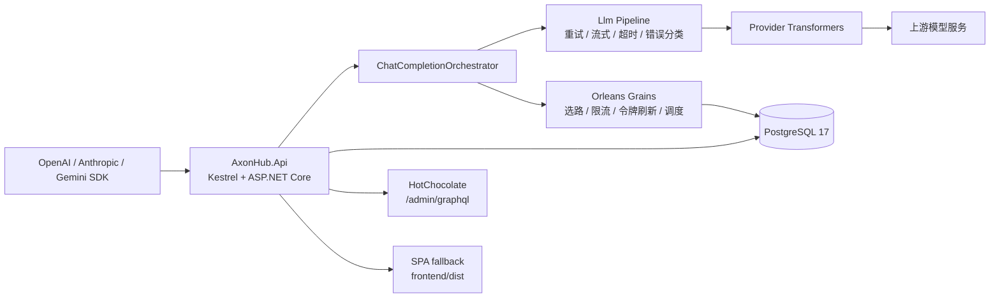

# AxonHub.NET

AxonHub 的 .NET 10 + Orleans 行为等价移植。

[](https://github.com/geffzhang/axonhub.net/actions/workflows/tests.yml)


[](LICENSE)

[上游 AxonHub](https://github.com/looplj/axonhub) · [文档](docs/zh/index.md) · [移植台账](porting/) · [验收账](porting/03-acceptance.md)

---

## 这是什么

**AxonHub.NET 是 [looplj/axonhub](https://github.com/looplj/axonhub) 的 .NET 移植版**：保留
AxonHub 的对外 API、管理面 GraphQL、渠道/模型/追踪/计费等行为，把 Go 运行时替换为
.NET 10 + ASP.NET Core + Orleans。

它适合这些场景：

- 需要在 .NET 技术栈内部署、扩展和排障 AI 网关；
- 需要同一套 OpenAI / Anthropic / Gemini 兼容接口对接多家上游；
- 关注与 Go 参照实现的**可观察行为等价**，而不是只做接口适配层。

> 本项目不是 AxonHub 官方发行版，也不代表上游团队。上游行为以
> [`porting/reference-lock.json`](porting/reference-lock.json) 锁定的提交为准；
> 所有与参照不一致的地方都登记在 [`porting/differences.jsonl`](porting/differences.jsonl)
> 并附原因与测试。

## 当前状态

| 范围 | 状态 |
| --- | --- |
| OpenAI Chat / Completions / Embeddings / Images / Audio / Video | ✅ 已移植 |
| OpenAI Responses（HTTP + WebSocket、流式、工具调用） | ✅ 已移植 |
| Anthropic Messages（非流式 / 流式 / 工具 / cache_control） | ✅ 已移植 |
| Gemini 原生协议、Gemini OpenAI 兼容层、Vertex | ✅ 已移植 |
| 渠道选择、自动禁用、限流、并发准入、配额路由 | ✅ 已移植 |
| 请求追踪、usage / 成本、模型库定价、备份与数据存储 | ✅ 已移植 |
| 管理面 REST + GraphQL + 前端资源 | ✅ 已移植 |
| 多 silo 集群（AdoNet membership + durable reminder） | ✅ opt-in，默认单 silo |
| 部署资产（本地脚本、systemd、Nginx、Helm） | ✅ 见 [`deploy/`](deploy/) |
| Go 参照行为对照与差异台账 | ✅ 336 条，0 个未解释缺口 |
| 本地测试 | **11161 例**（见[测试](#测试)） |
| 远端 CI | Llm / Grains / Persistence / 真实 provider E2E 全绿；Api 全量 nightly |

### 支持的渠道

| 类型 | 渠道 |
| --- | --- |
| 原生协议 | OpenAI、Anthropic、Gemini、Gemini Vertex、Anthropic on AWS Bedrock、Anthropic on GCP |
| OpenAI 兼容 | DeepSeek、Moonshot、Zhipu / ZAI、MiniMax、Doubao / Volcengine、Bailian、ModelScope、OpenRouter、Cerebras、Groq、Fireworks、xAI、OpenCode、Cline、NanoGPT、ZenMux |
| Coding / OAuth | Codex、Claude Code、GitHub Copilot、Antigravity、xAI Subscription、Command Code |
| 专用能力 | Jina Embedding / Rerank、TypeSafe SystemOne、Doubao Seedance 视频、ZenMux 视频 |

完整渠道类型与端点映射以
[`ChannelOutboundFactory`](src/AxonHub.Api/Orchestration/ChannelOutboundFactory.cs) 为准。

## 架构



| 项目 | 职责 |
| --- | --- |
| [`src/AxonHub.Abstractions`](src/AxonHub.Abstractions) | 渠道凭据、API 格式、共享抽象 |
| [`src/AxonHub.Llm`](src/AxonHub.Llm) | 统一 LLM 模型、HTTP/SSE、pipeline、所有 provider transformer |
| [`src/AxonHub.Grains.Abstractions`](src/AxonHub.Grains.Abstractions) | Orleans grain 契约与候选模型 |
| [`src/AxonHub.Grains`](src/AxonHub.Grains) | 选路、限流器、令牌刷新、定时任务、通道池状态 |
| [`src/AxonHub.Persistence`](src/AxonHub.Persistence) | EF Core 写侧、Dapper 读侧、PostgreSQL schema/迁移 |
| [`src/AxonHub.Api`](src/AxonHub.Api) | Kestrel 宿主、REST/GraphQL 端点、鉴权、编排、静态资源 |
| [`frontend/`](frontend) | 管理面 React SPA（与上游前端同源） |
| [`tools/AxonHub.CorpusRunner`](tools/AxonHub.CorpusRunner) | 差分语料回放器 |
| [`porting/`](porting) | 参照物锁定、行为基线、差异台账、验收账 |

## 快速开始

### 前置条件

- [.NET SDK 10.0.4xx](https://dotnet.microsoft.com/)
- PostgreSQL 17（或兼容版本）
- 可选：Docker（运行 PostgreSQL / 跑持久化测试）
- 可选：Node.js + pnpm 10（重新构建前端）

### 1. 启动 PostgreSQL

```bash
docker run -d --name axonhub-postgres \
  -e POSTGRES_USER=axonhub \
  -e POSTGRES_PASSWORD=axonhub \
  -e POSTGRES_DB=axonhub \
  -p 5432:5432 \
  postgres:17-alpine
```

### 2. 启动 API

```bash
git clone https://github.com/geffzhang/axonhub.net.git
cd axonhub.net

export ConnectionStrings__Default="Host=localhost;Port=5432;Database=axonhub;Username=axonhub;Password=axonhub"
export ASPNETCORE_HTTP_PORTS=8080
dotnet run --project src/AxonHub.Api
```

PowerShell：

```powershell
$env:ConnectionStrings__Default = "Host=localhost;Port=5432;Database=axonhub;Username=axonhub;Password=axonhub"
$env:ASPNETCORE_HTTP_PORTS = "8080"
dotnet run --project src/AxonHub.Api
```

示例监听 `http://localhost:8080`；可用 `ASPNETCORE_HTTP_PORTS` 或
`ASPNETCORE_URLS` 修改端口。

### 3. 初始化并创建第一个 API Key

打开 <http://localhost:8080>，按初始化向导创建管理员、项目和第一个 API Key；
随后在 **Channels（渠道）** 中添加上游、配置模型并启用。

仅使用 API 时，也可以直接调用管理端点：

```bash
curl http://localhost:8080/health
```

### 4. 前端

管理面静态资源默认从 `frontend/dist` 读取。首次使用或修改前端后构建：

```bash
cd frontend
corepack enable
pnpm install --frozen-lockfile
pnpm build
```

开发模式（Vite，默认 5173，代理到 API）：

```bash
VITE_API_URL=http://localhost:8080 pnpm dev
```

### 5. Docker Compose（推荐）

仓库根目录的 [`docker-compose.yml`](docker-compose.yml) 会构建 API 镜像、
启动 PostgreSQL 17，并把 [`config.example.yml`](config.example.yml) 挂载为
容器内的 `/app/config.yml`：

```bash
docker compose up --build
```

打开 <http://127.0.0.1:8090/> 使用管理界面。默认只绑定回环地址；
本机以外的部署请设置 `DB_PASSWORD` 和 `AXONHUB_BIND_ADDRESS`：

```bash
DB_PASSWORD='change-me' AXONHUB_BIND_ADDRESS=0.0.0.0 docker compose up --build
```

停止并保留数据库卷：`docker compose down`；同时删除数据卷：
`docker compose down -v`。

Kubernetes 多副本需要打开 `OrleansCluster:Enabled=true`，使用共享
PostgreSQL 的 AdoNet membership + reminder；见
[Kubernetes 多副本](docs/zh/getting-started/kubernetes.md)。

### 6. 单镜像 Docker

```bash
docker build -t axonhub.net .

docker run --rm -p 8080:8080 \
  --add-host=host.docker.internal:host-gateway \
  -e ConnectionStrings__Default="Host=host.docker.internal;Port=5432;Database=axonhub;Username=axonhub;Password=axonhub" \
  axonhub.net
```

镜像在构建阶段自动编译 `frontend/dist`，并复制到容器内的
`/app/frontend/dist`；启动后直接访问 `http://localhost:8080/` 即可使用管理界面。
如需替换界面，可覆盖 `Server:Static:Root` 或挂载该目录。

### 7. 原生安装与 Helm

[`deploy/`](deploy/README.md) 提供与 .NET 架构对应的部署资产：

- Linux/macOS/Windows 源码发布安装脚本（自包含单文件，保留
  `config.yml`）；
- systemd / launchd / 计划任务自启动；
- 支持 SSE 与 Responses WebSocket 的 Nginx 反向代理；
- Helm chart：多副本时自动启用 Orleans AdoNet membership + durable reminder。

```bash
# Linux/macOS
sudo ./deploy/install.sh \
  --db-dsn "Host=127.0.0.1;Port=5432;Database=axonhub;Username=axonhub;Password=change-me"
./deploy/start.sh

# Kubernetes
helm upgrade --install axonhub deploy/helm -n axonhub --create-namespace \
  --set axonhub.image.repository=your-registry/axonhub.net \
  --set axonhub.image.tag=0.1.0 \
  --set postgresql.auth.password='change-me'
```

完整说明见 [`deploy/README.md`](deploy/README.md) 和
[`deploy/helm/README.md`](deploy/helm/README.md)。

## 配置

配置来源按优先级从高到低：命令行参数 > 环境变量 > `appsettings.*.json` >
`config.yml`。参照实现的 `config.yml` 可直接使用；端口通过
`YamlConfigurationSource` 将 snake_case 键转换为端口读取的
`Section:Key`，环境变量仍可覆盖文件。

| 配置 | 说明 |
| --- | --- |
| `ConnectionStrings:Default` / `ConnectionStrings__Default` | **必填**，PostgreSQL 连接串 |
| `config.yml` / `db.dsn` | 参照格式的 YAML；`db.dsn` 是连接串的回退来源 |
| `ASPNETCORE_HTTP_PORTS` | Kestrel 监听端口；单镜像示例 `8080`，compose 使用 `8090` |
| `Server:Port` | 未设置 ASP.NET Core URL 时的监听端口（`config.yml` 默认 8090） |
| `Server:Static:Root` | SPA 静态目录，默认 `frontend/dist` |
| `Server:RequestTimeout` / `Server:LlmRequestTimeout` | 请求与 LLM 请求超时 |
| `Server:Cors:*` / `Server:Trace:*` / `Server:SseKeepAlive:*` | CORS、追踪头与 SSE 保活 |
| `Gc:*` / `Metrics:*` | 垃圾回收计划与 OTel 指标 |
| `AXONHUB_SERVER_*` / `AXONHUB_LOG_*` / `AXONHUB_GC_*` / `AXONHUB_METRICS_*` | 参照实现的兼容环境变量拼写 |
| `ASPNETCORE_ENVIRONMENT` | `Development` / `Production`，影响 appsettings 文件名与日志 |

[`config.example.yml`](config.example.yml) 只列出现有端口实际使用的配置节。
参照的 `cache.*`、`log.*`、`provider_quota.*` 与 `server.safeguards` 运行时尚未
移植，文件内有明确说明。Linux 上 `SIGHUP` 会重新读取 `config.yml` 与
`appsettings`；仅使用环境变量时按启动值运行。

## 调用示例

在管理面创建 API Key 后，继续使用现有 SDK，只需修改 Base URL：

```python
from openai import OpenAI

client = OpenAI(
    base_url="http://localhost:8080/v1",
    api_key="ah-...",  # AxonHub API Key，不是上游 Key
)

reply = client.chat.completions.create(
    model="gpt-4o",
    messages=[{"role": "user", "content": "Hello"}],
)
print(reply.choices[0].message.content)
```

Anthropic SDK：

```python
from anthropic import Anthropic

client = Anthropic(
    base_url="http://localhost:8080",
    api_key="ah-...",
)

message = client.messages.create(
    model="claude-sonnet-4-5",
    max_tokens=256,
    messages=[{"role": "user", "content": "Hello"}],
)
```

常用入口：

| 入口 | 说明 |
| --- | --- |
| `POST /v1/chat/completions` | OpenAI Chat Completions |
| `POST /v1/responses` | OpenAI Responses（HTTP） |
| `/v1/responses` WebSocket | Responses WebSocket 传输 |
| `POST /v1/messages` | Anthropic Messages 兼容入口 |
| `POST /v1/embeddings` | OpenAI Embeddings |
| `POST /v1/images/generations` | OpenAI Images |
| `POST /v1/audio/*` | Speech / Transcription / Translation |
| `POST /v1/rerank` | Jina Rerank |
| `POST /admin/graphql` | 管理面 GraphQL |
| `/` | 管理面 SPA |

## 测试

```bash
# 纯单元/契约测试
dotnet test tests/AxonHub.Llm.Tests/AxonHub.Llm.Tests.csproj
dotnet test tests/AxonHub.Grains.Tests/AxonHub.Grains.Tests.csproj

# 持久化（需要 Docker / Testcontainers）
dotnet test tests/AxonHub.Persistence.Tests/AxonHub.Persistence.Tests.csproj

# Api 全量（约 35–45 分钟，不含真实 provider E2E）
dotnet test tests/AxonHub.Api.Tests/AxonHub.Api.Tests.csproj
```

最近一次本地结果：

| 测试项目 | 数量 | 结果 |
| --- | ---: | --- |
| `AxonHub.Llm.Tests` | 3437 | 3437/3437 |
| `AxonHub.Grains.Tests` | 95 | 95/95 |
| `AxonHub.Persistence.Tests` | 431 | 431/431 |
| `AxonHub.Api.Tests` | 7182 | 7164 通过 + 18 条 E2E 跳过，0 失败 |
| **合计** | **11145** | **11127 通过 / 0 失败 / 18 跳过** |

上表是最后一次全量实测。此后 §281–§285 新增 16 例（Api 15、Persistence 1）
已定向通过，未做合并全量复跑；当前套件总数为 **11161 例**。

### 真实 provider E2E

矩阵测试通过真实 `HttpExecutor` 访问本地
[LlmTestServer](https://github.com/managedcode/LlmTestServer)，覆盖
OpenAI、Anthropic、Gemini、Responses、Groq、Ollama、DeepSeek、OpenRouter
上游，以及流式、Embeddings、Images、工具调用和 429 换通道重试。

```bash
docker run --rm -d --name llm-test-server \
  -p 8080:8080 \
  -e LlmTestServer__RequiredBearerToken=test-key \
  ghcr.io/managedcode/llm-test-server:1.0.6

AXONHUB_E2E_LLM_TEST_SERVER_URL=http://localhost:8080 \
AXONHUB_E2E_LLM_TEST_SERVER_KEY=test-key \
  dotnet test tests/AxonHub.Api.Tests/AxonHub.Api.Tests.csproj \
  --filter FullyQualifiedName~LlmTestServer
```

未设置 `AXONHUB_E2E_LLM_TEST_SERVER_URL` 时，这 18 条测试自动跳过。
CI 中的 `e2e-llm` job 使用固定 digest 的同一镜像运行它们。

## CI

| 工作流 | 内容 |
| --- | --- |
| [`tests.yml`](.github/workflows/tests.yml) | Llm / Grains / Persistence / 真实 provider E2E；Api 全量 nightly 或手动 |
| [`porting-guard.yml`](.github/workflows/porting-guard.yml) | 差异台账 lint、路由表面、差分语料、参照物锁定 |

本地可单独运行移植守护：

```bash
python -I porting/scripts/diff_register.py lint
python -I porting/scripts/diff_register.py render
python -I porting/scripts/http_route_audit.py --port src/AxonHub.Api
python -I porting/scripts/reference_lock.py check \
  --repo ../axonhub-ref --dest porting/reference-lock.json
```

## 项目结构

```text
src/
  AxonHub.Api/                  HTTP/GraphQL 宿主与业务编排
  AxonHub.Llm/                  LLM pipeline 与 provider 变换
  AxonHub.Grains/               Orleans actor 实现
  AxonHub.Grains.Abstractions/  grain 契约与候选模型
  AxonHub.Persistence/          EF Core + Dapper + PostgreSQL
  AxonHub.Abstractions/         共享抽象
tests/                          4 个测试项目 + 真实 provider E2E
frontend/                       管理面 React SPA
deploy/                         本地安装、systemd、Nginx、Helm
tools/AxonHub.CorpusRunner/     差分语料运行器
porting/                        三本账与守护脚本
corpus/                         差分语料
```

## 移植口径

- **参照物**：上游 `looplj/axonhub`，锁定
  `b8bb3421e1fe946cfc4f0d86e8412098738f2793`（v1.0.0-beta11）；
  部分切片按漂移记录跟进到 live `f272549f`，逐条记录在
  [`porting/00-reference.md`](porting/00-reference.md)。
- **验收标准**：可观察行为等价，不是逐行翻译。HTTP 路由、GraphQL 根字段、
  错误文案、流式事件顺序、工具调用、usage/成本、事务与并发语义均有测试。
- **差异**：所有已知差异编号为 `C###`，记录现象、原因、决策与测试；
  当前 **336 条（191 accepted / 145 resolved / 0 gap）**，见
  [`porting/differences.jsonl`](porting/differences.jsonl) 与
  [`porting/02-differences.md`](porting/02-differences.md)。
- **验收**：测试总数、通过/失败/跳过、公开 API 表面、容器冒烟与 E2E
  记录在 [`porting/03-acceptance.md`](porting/03-acceptance.md)。
- **语料与守护**：`corpus/` 的请求/响应/流式语料由
  [`AxonHub.CorpusRunner`](tools/AxonHub.CorpusRunner) 回放比对。

## 已知限制

- **仅支持 PostgreSQL**：参照支持的 SQLite 模式尚未移植（C011）。
- **GCP 交互式 OAuth 未支持**：仅 service account / authorized user /
  external account 等非交互凭据（C128）。
- **WebSocket 传输**：端口自写 TLS/SSE 不声明 ALPN，因此 WebSocket 走
  HTTP/1.1（上游 #2664）。
- **前端构建**：Docker 构建阶段需要访问 npm registry 下载前端依赖；运行镜像本身不依赖 Node。
- **平台验证**：目前主要在本机 Windows 11 + PostgreSQL 17 验证；Linux
  容器冒烟与 CI 已覆盖主要路径，跨平台矩阵仍可继续扩展。
- 部分 live 特性按切片局部跟进；未跟进项均登记在差异台账，不以“未实现”
  隐式存在。

## 许可证

本项目沿用上游 AxonHub 的 [Apache License 2.0](LICENSE)。上游代码与文档的
版权归其作者所有；.NET 移植部分的改动同样以 Apache-2.0 发布。

## 致谢

- [looplj/axonhub](https://github.com/looplj/axonhub)：协议、行为与前端
- [Orleans](https://github.com/dotnet/orleans)：actor 运行时
- [HotChocolate](https://chillicream.com/docs/hotchocolate)：管理面 GraphQL
- [LlmTestServer](https://github.com/managedcode/LlmTestServer)：真实 provider E2E
