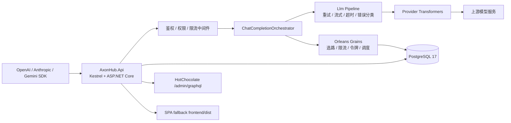

# 架构

AxonHub.NET 以可观察行为等价为目标移植上游 AxonHub：对外协议、管理面
GraphQL、管理界面和业务语义保持一致，内部运行时替换为 .NET 10 + ASP.NET
Core + Orleans。

## 总览

## 项目分层

| 项目 | 职责 | 关键入口 |
| --- | --- | --- |
| `AxonHub.Abstractions` | 渠道凭据、API 格式、共享抽象 | `ChannelCredentials`、`ApiFormats` |
| `AxonHub.Llm` | 统一请求/响应、pipeline、HTTP/SSE、provider 变换 | `Pipeline`、`ITransformer`、`Transformer/` |
| `AxonHub.Grains.Abstractions` | Orleans grain 契约与候选模型 | `ChannelCandidate`、grain interfaces |
| `AxonHub.Grains` | 选路、限流器、通道池、令牌刷新、调度 | `ChannelPoolGrain`、`ChannelTokenGrain` |
| `AxonHub.Persistence` | EF Core 写侧、Dapper 读侧、PostgreSQL schema | `AxonHubDbContext`、`Stores/` |
| `AxonHub.Api` | Kestrel 宿主、REST/GraphQL、鉴权、编排、静态资源 | `Program.cs`、`Orchestration/` |

## 请求链路

1. Kestrel 接收请求，IP 访问控制/超时/鉴权中间件按参照顺序执行。
2. 入站 transformer 把 OpenAI / Anthropic / Gemini / Responses 请求转换为
   `LlmRequest`。
3. `ChatCompletionOrchestrator` 执行模型访问检查、配额、提示词注入/保护。
4. `ModelCandidateSelector` 通过 Orleans `ChannelPoolGrain` 获取启用通道快照，
   按模型关联、优先级、负载均衡策略排序候选。
5. `Pipeline` 选择候选的 outbound transformer，执行请求：
   - 同通道重试会推进模型并在重试前重读渠道凭据；
   - 跨通道切换使用同一候选预算；
   - 流式响应按 SSE/NDJSON 逐事件转换；
   - 错误经过传输分类和 `upstream_error_policy`。
6. outbound transformer 把统一请求转换为上游协议，`HttpExecutor` 发出请求。
7. 响应/流按入站协议转换回客户端，并写入 request、execution、usage log。

## Orleans 模型

上游的进程内 ChannelService/缓存/限流状态在端口拆成 grain：

| Grain | 作用 |
| --- | --- |
| `ChannelPoolGrain` | 启用通道池快照、打分与候选排序 |
| `ChannelTokenGrain` | OAuth 令牌刷新与乐观并发写回 |
| `ChannelLimiterGrain` / 管理服务 | RPM/TPM/并发准入与冷却 |
| 定时 grain | 自动备份、GC、provider quota、channel probe、视频清理 |
| trace/thread 粘性状态 | 会话/追踪路由连续性 |

grain 的单线程 actor 语义替代了 Go 侧的 process-local 锁；跨实例行为由
PostgreSQL 与 grain 键保证。

## 持久化

写侧使用 EF Core，读侧使用 Dapper，两者共享同一连接/事务：

- `AxonHubDbContext`：行模型与写入事务；
- `Stores/`：手写查询、键集分页、聚合；
- `DatabaseSchema`：启动时幂等 DDL（25 张表）；
- `PostgresConnectionFactory`：EF/Dapper 的连接与事务接缝。

仅支持 PostgreSQL；参照的 SQLite/MySQL 与读副本未移植，见
[移植台账](porting.md)。

## 配置与宿主

- `Program.cs` 先运行 CLI 子命令，再构建 WebApplication；
- `config.yml` 通过 `YamlConfigurationSource` 加载，环境变量/appsettings
  后加载以保持参照优先级；
- 静态资源默认来自 `frontend/dist`，Docker 镜像在构建阶段生成该目录；
- GraphQL 使用 HotChocolate code-first，管理面路径为 `/admin/graphql`。

## 与 Go 参照的对应关系

| Go 参照 | .NET 端口 |
| --- | --- |
| `llm/transformer` + `llm/pipeline` | `AxonHub.Llm` |
| `internal/server/biz` 部分服务 | `AxonHub.Api/Management`、`Orchestration` |
| 进程内通道缓存与状态 | Orleans grains |
| Ent + pgx | EF Core + Dapper + Npgsql |
| go:embed 前端 | 运行镜像内 `frontend/dist` + SPA fallback |

具体差异、原因和测试见[差异台账](../../../porting/02-differences.md)与
[验收账](../../../porting/03-acceptance.md)。
